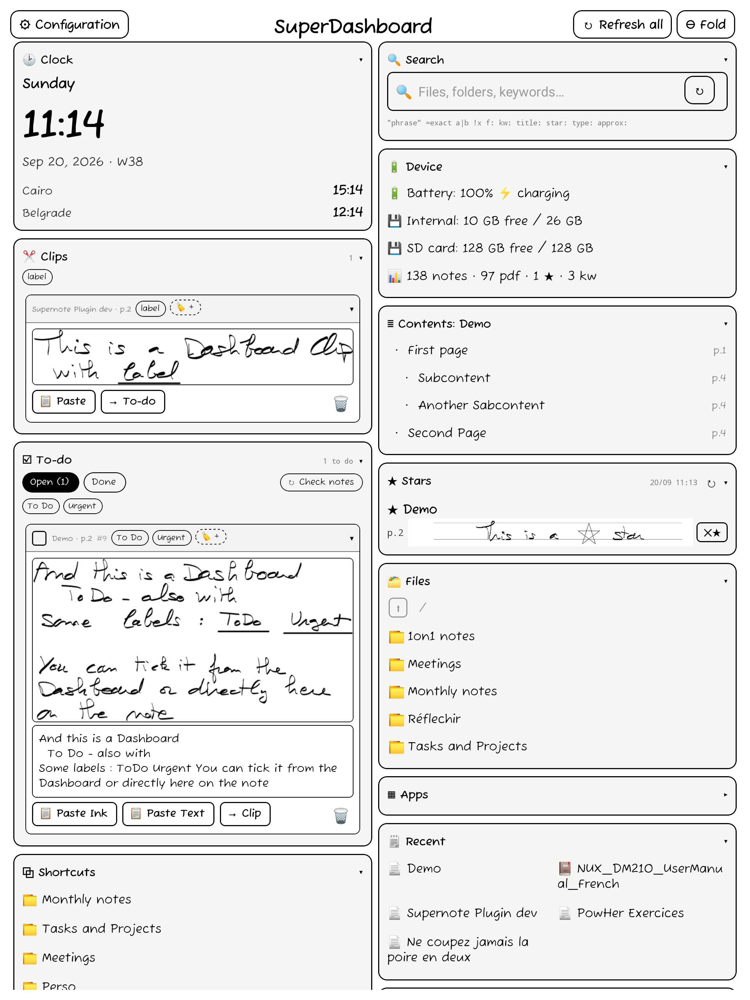

# SuperDashboard (Supernote plugin)

A configurable, always-available dashboard for Supernote e-ink devices. Its face is a draggable
**bubble** (the house logo) that floats over everything; tap it to open the dashboard, drag it to move
it (or open it from the plugin's toolbar button). You compose the dashboard yourself from **modules**,
in 1, 2 or 3 columns, in the design and font you like. It runs **fully on-device and offline**: no
account, no network.



📖 **[User Guide](USER_GUIDE.md)** (full walkthrough: install, configuration, every module, tips) ·
⬇ **[Latest release](../../releases/latest)**

## Modules

- **Shortcuts**: open a folder, note, PDF or EPUB in one tap.
- **Files**: a small in-dashboard file browser.
- **Search**: file & folder names, keywords, and note headings, with a compact query grammar.
- **Contents**: the current note's headings as a tappable outline; tap one to jump to its page.
- **Recent**: your recent notes and documents (including on an SD card).
- **Stars**: five-star pages from a scan, grouped by note, with optional line previews.
- **Keywords**: note keywords as tappable chips, each opening its note on the right page.
- **Clock**: time, date, week number and extra time zones, in a choice of faces.
- **Device**: battery, free storage and a library stats line.
- **Apps**: launchers for your device apps.
- **Note Clips**: snippets you lassoed from notes (or PDFs / EPUBs, or selected PDF text), as labelled
  thumbnails you can paste back as native ink or editable text.
- **To-do**: tasks captured the same way; a note task gets a tick-box you check from the dashboard or by
  hand, a PDF / EPUB task is dashboard-only.
- **Empty**: a spacer to line columns up (preset or exact px height).

Blocks arrange in 1 / 2 / 3 columns (masonry or fixed height), collapse to their title, and each has an
**ⓘ** help button in Settings. The **[User Guide](USER_GUIDE.md)** explains how every module works and
how to configure it.

## Which version do I need?

Supernote's firmware is called **Chauvet**; what matters is the version number. A build made for one
firmware does not run on the other, so pick the release that matches your device (check it in device
settings):

| Your Chauvet version | Download |
|---|---|
| Older than 3.29.43 (Manta / Nomad) / 2.26.40 (A5 X / A6 X) | **v0.22.0** |
| 3.29.43 (Manta / Nomad) / 2.26.40 (A5 X / A6 X) or later | **[latest release](../../releases/latest)** |

**Install**: copy the `.snplg` into your device's **`MyStyle`** folder, then on the device
**Settings -> Apps -> Plugins -> Choose Installation Package**. SuperDashboard declares **no INTERNET
permission**; on first run it asks once for **file access** (READ/WRITE) to scan and open your files and
save its settings. Full install and permission details are in the [User Guide](USER_GUIDE.md).

## Build from source

```bash
source ../env.sh                    # JDK 21 + Android SDK on PATH
./buildPlugin.sh                    # -> build/outputs/SuperDashboard.snplg
# install on device: Settings -> Apps -> Plugins -> Choose Installation Package (pick the .snplg)
```

Capabilities validated on A5X + Manta are written up in `docs/FINDINGS.md` and the `supernote-plugin-dev`
skill under `.claude/skills/`.

On Windows, with Node.js, JDK 17 or newer and the Android SDK installed:

```powershell
npm.cmd ci --ignore-scripts --no-audit --no-fund
$env:ANDROID_HOME = "$env:LOCALAPPDATA\Android\Sdk" # adjust for your SDK installation
.\buildPlugin.ps1 # release native code, ARM64; build\outputs\SuperDashboard.snplg
```

The Windows build defaults to `Release`, selects only that variant's custom native package,
and stops if native compilation or packaging fails. Use `-BuildVariant Debug` only for development;
do not deploy a debug build for regular use. The internal `app.npk` is loaded by PluginHost, not
installed as a standalone APK. USB-copy the `.snplg` into `MyStyle`, then use the device's plugin
installer; copying alone does not activate the plugin. Local security changes redact OCR text,
automatic labels, and the lasso capture's source path from capture diagnostics. Existing diagnostic
files and cloud copies are not deleted.

## Support

SuperDashboard is a personal project built by a Supernote user, for Supernote users. If it saves you a
few taps every day, a small contribution is appreciated: https://ko-fi.com/agp42
